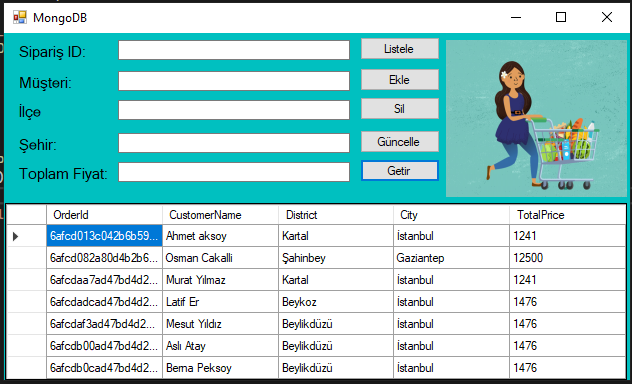

# MongoDB Order Management Project

## 📌 Proje Hakkında
Bu proje, C# Windows Forms kullanılarak geliştirilmiş basit bir sipariş yönetim uygulamasıdır. MongoDB veritabanı ile bağlantı kurularak sipariş kayıtları üzerinde CRUD (Create, Read, Update, Delete) işlemleri gerçekleştirilmektedir.

## 🖥️ Uygulama Görüntüsü

## ⚙️ Özellikler
- **Sipariş Ekleme:** Müşteri adı, ilçe, şehir ve toplam tutar bilgileriyle yeni sipariş kaydı oluşturma.
- **Sipariş Listeleme:** MongoDB veritabanındaki siparişleri DataGridView üzerinde görüntüleme.
- **Sipariş Silme:** MongoDB tarafından otomatik oluşturulan ObjectId üzerinden sipariş silme.
- **Sipariş Güncelleme:** Mevcut sipariş bilgilerini güncelleme.
- **ID ile Sipariş Getirme:** Belirli bir siparişi ObjectId kullanarak sorgulama.

## 🛠️ Kullanılan Teknolojiler
- C#
- Windows Forms
- MongoDB
- MongoDB.Driver
- BSON
- Visual Studio

## 🗄️ Veritabanı Yapısı
Sipariş kayıtlarında aşağıdaki alanlar kullanılmaktadır:

| Alan | Açıklama |
|---|---|
| _id | MongoDB tarafından otomatik oluşturulan benzersiz kimlik |
| CustomerName | Müşteri adı |
| District | İlçe |
| City | Şehir |
| TotalPrice | Toplam sipariş tutarı |

## 📚 Öğrenilen Konular
- MongoDB bağlantısı oluşturma
- Collection üzerinden veri işlemleri gerçekleştirme
- `InsertOne()` ile kayıt ekleme
- `Find()` ile kayıtları listeleme ve filtreleme
- `DeleteOne()` ile kayıt silme
- `UpdateOne()` ile kayıt güncelleme
- `ObjectId` kullanımı
- C# ile MongoDB işlemlerini yönetme

## 🎯 Projenin Amacı
Bu projenin amacı, C# Windows Forms uygulamalarında MongoDB kullanarak temel veritabanı işlemlerini öğrenmek ve NoSQL veritabanı mantığını uygulamalı olarak pekiştirmektir.
